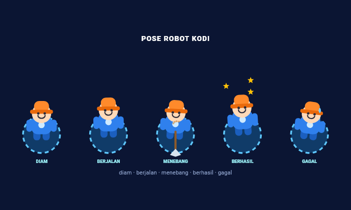
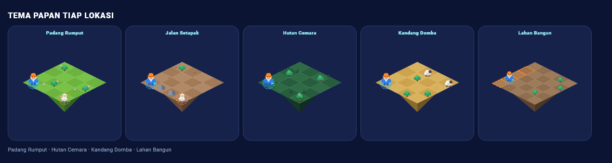
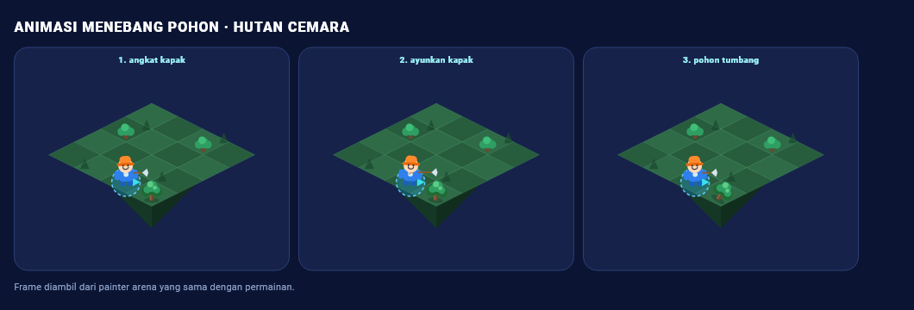
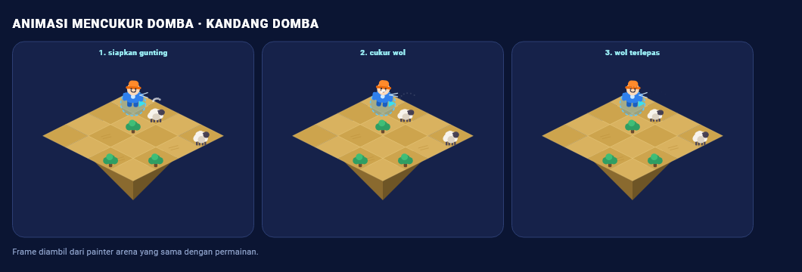
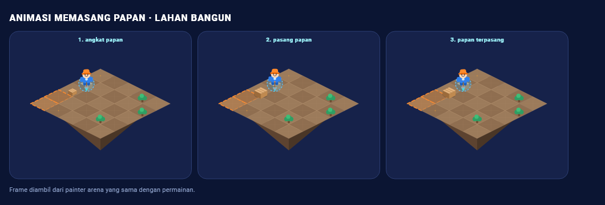
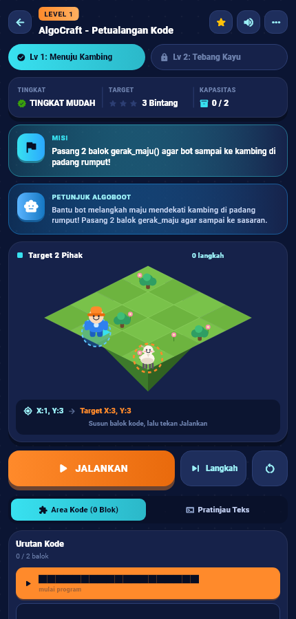
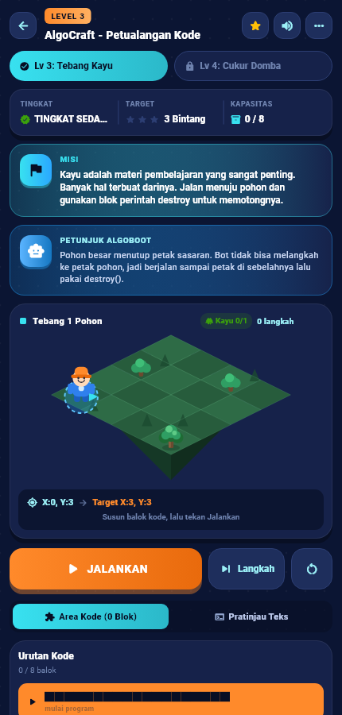
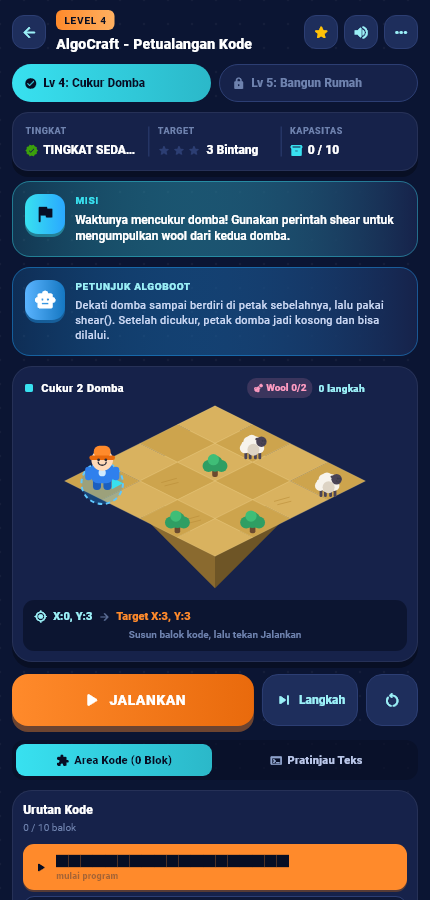
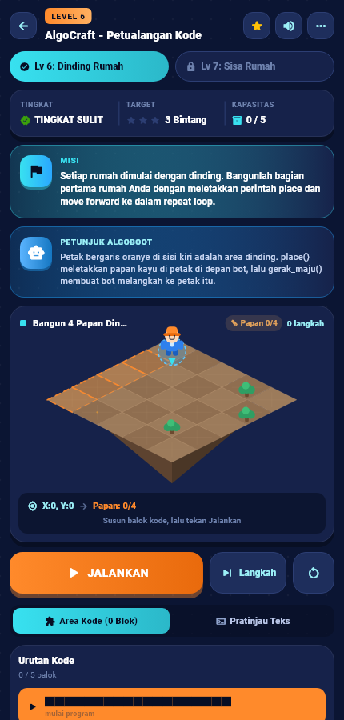
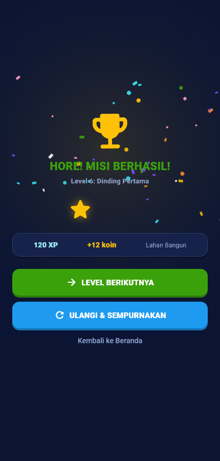

# LAPORAN MINGGUAN PERKEMBANGAN PROYEK

## AlgoCraft Versi 1.2.0 — Aset Visual dan Animasi

**Nama:** Zainul Irfan
**NIM:** 2413025049
**Program Studi / Kelas:** Pendidikan Teknologi Informasi / 2024A
**Fakultas:** Fakultas Keguruan dan Ilmu Pendidikan
**Universitas:** Universitas Lampung
**Tanggal Pelaporan:** 5 November 2026
**Periode:** November 2026 / Minggu ke-1

---

## A. IDENTITAS PROYEK

| Komponen | Keterangan |
|---|---|
| Nama Proyek | Pengembangan Game Edukasi AlgoCraft Berbasis Flutter |
| Nama Aplikasi | AlgoCraft |
| Nama Ketua Tim | Zainul Irfan |
| Anggota Tim | Proyek dikerjakan secara mandiri (individu) |
| Program Studi / Kelas | Pendidikan Teknologi Informasi / 2024A |
| Dosen Pengampu | 1. Dr. Afif Rahman Riyanda, S.Pd., M.Pd.T.<br>2. Ghea Chandra Surawan, M.Pd. |
| Periode / Minggu Ke- | November 2026 / Minggu ke-1 |
| Tanggal Pelaporan | 5 November 2026 |
| Platform Pengembangan | Flutter Web (Chrome), Android, dan Windows |
| Teknologi | Dart, Flutter, flutter_svg, audioplayers, shared_preferences |
| Versi Aplikasi | **1.2.0+2** |

## B. TUJUAN DAN TARGET MINGGUAN

**Target utama:** memperkaya aset visual dan animasi robot Kodi serta papan permainan AlgoCraft tanpa mengubah logika permainan, progres, atau penilaian bintang.

**Target teknis:**

1. Robot Kodi memiliki pose diam, berjalan, menebang, berhasil, dan gagal; kostum yang sedang dipakai ikut tampil.
2. Program yang dijalankan menampilkan animasi gerak, belok, dan lompat.
3. Papan permainan memakai tema berbeda untuk lima lokasi level, mencakup tujuh level.
4. Objek papan beranimasi: pohon tumbang, domba dicukur, serta blok/papan muncul.
5. Layar berpindah dengan animasi transisi dan layar hasil menampilkan efek perayaan.
6. Animasi tetap ringan, tidak mengubah hasil eksekusi, dan lolos pengujian otomatis pada berbagai lebar layar.

**Luaran yang diharapkan:** aplikasi AlgoCraft versi 1.2.0, kode program, tangkapan layar bukti, dan laporan mingguan.

## C. REALISASI PERKEMBANGAN PROYEK

| No. | Aktivitas Pengembangan | Target Mingguan | Hasil yang Dicapai | Status |
|---|---|---|---|---|
| C1 | Eksplorasi aset dan pemetaan visual | Aset dan struktur animasi disiapkan | Sprite Kodi, pohon, dan domba dipetakan ke komponen visual baru `lib/arena_visuals.dart`; painter arena lama dipertahankan. | Selesai |
| C2 | Pose robot Kodi dan kostum | Pose diam, jalan, tebang, berhasil, gagal | Delapan pose (idle, walk, jump, chop, shear, build, happy, sad), transformasi tubuh, efek aksi, dan overlay enam kategori kostum. | Selesai |
| C3 | Animasi gerak, belok, dan lompat | Gerakan terlihat saat program berjalan | Posisi robot diinterpolasi per frame; belok memutar arah 230 ms; lompat memakai busur dan bayangan; animasi ditunggu sebelum blok berikutnya. | Selesai |
| C4 | Animasi objek papan | Pohon tumbang, domba dicukur, papan muncul | Pohon berotasi dan memudar, domba mengecil dengan bulu beterbangan, papan tumbuh dengan material kayu/batu. | Selesai |
| C5 | Tema papan lima lokasi | Tema berbeda untuk tujuh level | Lima `BoardTheme`: Padang Rumput, Jalan Setapak, Hutan Cemara, Kandang Domba, dan Lahan Bangun; dekorasi petak deterministik. | Selesai |
| C6 | Transisi layar dan perayaan hasil | Perpindahan dan layar hasil lebih hidup | `playfulRoute` (fade + slide 380 ms), piala memantul, bintang muncul bertahap, dan 46 potong konfeti selama 2,4 detik. | Selesai |
| C7 | Pengujian dan dokumentasi | Animasi tidak mengubah logika | `flutter analyze` bersih; 21 pengujian lulus, termasuk penyelesaian level 1/3/4/6/7, kostum, tema, dan lebar layar 320–768 px. | Selesai |

## D. DETAIL FITUR YANG DIKEMBANGKAN

| No. | Nama Fitur | Deskripsi dan Fungsi | Teknologi / Komponen | Status |
|---|---|---|---|---|
| D1 | Pose dan kostum Kodi | Pose mengubah rotasi, kemiringan, tinggi, dan efek aksi. Topi, baju, sepatu, syal, sayap, dan aksesoris digambar sebagai overlay di atas sprite sehingga kostum yang dibeli langsung terlihat di arena. | `RobotPose`, `paintKodi`, `equippedCostume`, `CostumeCategory` | Selesai |
| D2 | Animasi eksekusi blok | Posisi dan arah robot diinterpolasi. Durasi: belok 230 ms, maju 330 ms, lompat 360 ms, tebang/cukur 620 ms, pasang papan 520 ms, gagal 420–520 ms, berhasil 650 ms. | `AnimationController`, `_playAction`, `_ArenaPainter` | Selesai |
| D3 | Animasi objek papan | Pohon yang ditebang berotasi ke samping dan memudar; domba yang dicukur mengecil dan mengeluarkan gumpalan wol; papan baru tumbuh dari petak dengan warna material yang dipilih. | `activeTree`, `activeSheep`, `activePlank`, `poseT` | Selesai |
| D4 | Tema papan | Warna atas, sisi, tepi, aksen, dan dekorasi petak berbeda per lokasi. Level 5 (`Lahan Kosong`) dan level 6–7 (`Lahan Bangun`) memakai tema Lahan Bangun. | `BoardTheme.of(location)`, `BoardDecor` | Selesai |
| D5 | Transisi dan perayaan | Navigasi memakai fade + slide. Layar hasil menampilkan piala berdenyut, bintang bertahap, dan konfeti yang tidak menghalangi teks. | `playfulRoute`, `LevelCompleteScreen`, `ConfettiPainter` | Selesai |
| D6 | Kinerja dan keterbacaan | Arena dibungkus `RepaintBoundary`; hanya arena yang digambar ulang saat animasi. Tata letak diuji pada lebar 320, 360, 430, dan 768 px; teks panjang memakai ellipsis dan tombol memakai `FittedBox`. | `RepaintBoundary`, `AnimatedBuilder`, `FittedBox` | Selesai |

### Catatan kecepatan animasi

Durasi animasi mengikuti jenis aksi, bukan mengubah kecepatan logika. Pada mode **Langkah**, animasi selalu ditunggu selesai sebelum instruksi berikutnya dijalankan. Dengan begitu, pengguna dapat mengamati setiap gerakan tanpa mengubah hasil akhir program.

## E. BUKTI PERKEMBANGAN PROYEK

### E1. Pose robot Kodi



**Gambar E.1** — Pose diam, berjalan, menebang, berhasil, dan gagal. Galeri ini dirender dari painter yang sama dengan arena permainan.

### E2. Tema papan lima lokasi



**Gambar E.2** — Padang Rumput, Jalan Setapak, Hutan Cemara, Kandang Domba, dan Lahan Bangun.

### E3. Animasi objek papan



**Gambar E.3** — Rangkaian animasi menebang pohon: angkat kapak, ayunkan kapak, pohon tumbang.



**Gambar E.4** — Rangkaian animasi mencukur domba: siapkan gunting, cukur wol, wol terlepas.



**Gambar E.5** — Rangkaian animasi memasang papan: angkat papan, pasang papan, papan terpasang.

### E4. Arena permainan per tema

| Padang Rumput (level 1) | Hutan Cemara (level 3) |
|---|---|
|  |  |

| Kandang Domba (level 4) | Lahan Bangun (level 6) |
|---|---|
|  |  |

### E5. Kostum tampil di arena


**Gambar E.6** — Robot memakai Topi Petualang, Baju Kaos, dan Syal Biru. Overlay kostum mengikuti pose dan arah robot.

### E6. Layar hasil dengan perayaan



**Gambar E.7** — Layar hasil menampilkan piala, tiga bintang, XP, koin, dan konfeti.

### E7. Cuplikan kode animasi

```dart
/// Menjalankan satu animasi aksi dan menunggu sampai selesai.
/// Durasi menyesuaikan jenis aksi, bukan kecepatan logika.
Future<void> _playAction(Duration duration) async {
  if (!mounted) return;
  _actionCtrl.duration = duration;
  try {
    await _actionCtrl.forward(from: 0);
  } on TickerCanceled {
    // Layar ditutup di tengah animasi - hentikan dengan tenang.
  }
}
```

```dart
final oldR = _row, oldC = _col;
setState(() {
  _row = nr;
  _col = nc;
  _moves++;
  _status = '${cmd.code} \u00b7 ${cmd.sub}';
  _fromRow = oldR.toDouble();
  _fromCol = oldC.toDouble();
  _toRow = nr.toDouble();
  _toCol = nc.toDouble();
  _robotJump = jump;
  _pose = jump ? RobotPose.jump : RobotPose.walk;
});
await _playAction(Duration(milliseconds: jump ? 360 : 330));
_settleVisual();
```

```dart
static BoardTheme of(String location) {
  switch (location) {
    case 'Padang Rumput':
      return padangRumput;
    case 'Jalan Setapak':
      return jalanSetapak;
    case 'Hutan Cemara':
      return hutanCemara;
    case 'Kandang Domba':
      return kandangDomba;
    case 'Lahan Kosong':
    case 'Lahan Bangun':
      return lahanBangun;
    default:
      return padangRumput;
  }
}
```

### E8. Hasil pengujian otomatis

Perintah yang dijalankan:

```text
flutter analyze
flutter test
```

Hasil:

```text
Analyzing game irfan...
No issues found! (ran in 1.7s)

00:06 +21: All tests passed!
```

| No. | Berkas | Nama Pengujian | Hasil |
|---|---|---|---|
| 1 | visual_test.dart | Tema papan berbeda untuk lima lokasi | Lulus |
| 2 | visual_test.dart | Pose robot mencakup diam, jalan, tebang, berhasil, gagal | Lulus |
| 3 | visual_test.dart | Arena level 1 tidak overflow pada lebar 320 | Lulus |
| 4 | visual_test.dart | Arena level 1 tidak overflow pada lebar 360 | Lulus |
| 5 | visual_test.dart | Arena level 1 tidak overflow pada lebar 430 | Lulus |
| 6 | visual_test.dart | Arena level 1 tidak overflow pada lebar 768 | Lulus |
| 7 | visual_test.dart | Tema papan dipakai sesuai lokasi level | Lulus |
| 8 | visual_test.dart | Level 1 tetap selesai dengan animasi aktif | Lulus |
| 9 | visual_test.dart | Animasi menebang tetap menyelesaikan level 3 | Lulus |
| 10 | visual_test.dart | Animasi mencukur tetap menyelesaikan level 4 | Lulus |
| 11 | visual_test.dart | Kostum terpasang tampil di arena tanpa galat | Lulus |
| 12 | visual_test.dart | Layar hasil menampilkan perayaan pada layar sempit | Lulus |
| 13 | visual_test.dart | Galeri pose Kodi dibangun tanpa galat aset | Lulus |
| 14 | widget_test.dart | AlgoCraftApp menampilkan shell utama | Lulus |
| 15 | widget_test.dart | Level 6 dan 7 tersedia di daftar level | Lulus |
| 16 | widget_test.dart | Level 6 selesai dengan place + ulangi_blok(4) | Lulus |
| 17 | widget_test.dart | Level 7 selesai dengan place + ulangi_blok(3) | Lulus |
| 18 | widget_test.dart | Progres disimpan: rekam menang, muat ulang, kunci peta | Lulus |
| 19 | shop_test.dart | Katalog Toko memiliki jumlah item sesuai kategori | Lulus |
| 20 | shop_test.dart | Toko tampil portrait, bisa filter dan membeli kostum | Lulus |
| 21 | shop_test.dart | Toko tidak overflow di layar 360x800 | Lulus |

Berkas bukti mentah tersedia di `docs/laporan/bukti/flutter-analyze.txt` dan `docs/laporan/bukti/flutter-test.txt`.

## F. KENDALA DAN SOLUSI

| No. | Kendala | Penyebab | Solusi / Tindakan | Status |
|---|---|---|---|---|
| F1 | Animasi harus selesai sebelum blok berikutnya | Eksekusi blok berjalan async | Semua aksi memakai `await _playAction(...)`; state logika baru diubah setelah animasi objek selesai. | Selesai |
| F2 | Layar ditutup saat animasi berjalan | Controller masih aktif | `TickerCanceled` ditangkap di `_playAction`, lalu state visual direset dengan aman. | Selesai |
| F3 | Teks pada tangkapan layar uji berbentuk kotak | Lingkungan `flutter_test` memakai font Ahem | Tes tangkapan layar memuat Roboto dan Material Icons asli dari `tool/fonts/`. | Selesai |
| F4 | Tombol dan teks terpotong di layar sempit | Lebar 320–360 px | Target info memakai `Expanded` + ellipsis; tombol JALANKAN dibungkus `FittedBox`; diuji pada empat lebar. | Selesai |
| F5 | Repaint berlebihan saat robot diam | Animasi idle berulang | Arena dibungkus `RepaintBoundary`; hanya area arena yang digambar ulang, bukan seluruh layar. | Selesai |
| F6 | Tangkapan layar animasi sulit diambil saat program berjalan | Animasi berdurasi pendek dan halaman dapat ter-scroll | Dibuat `ArenaShowcase` yang memakai painter arena yang sama dengan nilai pose/progress tetap, sehingga frame dapat direkam deterministik. | Selesai |

## G. EVALUASI PERKEMBANGAN

**Persentase progres:** 100% untuk target mingguan visual dan animasi versi 1.2.0.

**Target yang telah tercapai:**

- Semua pose robot dan kostum tampil di arena.
- Animasi gerak, belok, lompat, tebang, cukur, dan pasang papan berjalan.
- Lima tema papan dipakai sesuai lokasi level.
- Transisi layar dan perayaan hasil aktif.
- 21 pengujian otomatis lulus dan `flutter analyze` tidak menemukan masalah.
- Logika permainan, progres, dan penilaian bintang tidak berubah; penyelesaian level 1, 3, 4, 6, dan 7 tetap lulus.

**Target yang belum tercapai:** tidak ada untuk ruang lingkup mingguan ini. Fitur di luar lingkup, seperti multipemain, leaderboard daring, dan sinkronisasi backend, belum dikerjakan.

**Kualitas dan fungsi aplikasi:** aplikasi stabil, animasi berjalan ringan pada arena berukuran kecil, dan tata letak tetap terbaca pada lebar 320–768 px. Seluruh aset visual dirender dari kode aplikasi nyata, bukan mockup.

**Evaluasi kerja sama:** proyek dikerjakan secara mandiri. Analisis, perancangan, implementasi, pengujian, dan penyusunan laporan dilakukan oleh penyusun dengan bimbingan dosen pengampu.

## H. RENCANA KERJA MINGGU BERIKUTNYA

| No. | Aktivitas | Target Luaran | Penanggung Jawab | Target Waktu |
|---|---|---|---|---|
| H1 | Menyiapkan build web dan Android versi 1.2.0 | Berkas build siap dibagikan | Zainul Irfan | Minggu berikutnya |
| H2 | Menambahkan materi percabangan dan fungsi | Dua level baru dengan konsep `if` dan fungsi | Zainul Irfan | Minggu berikutnya |
| H3 | Menyempurnakan animasi transisi dan audio | Pengalaman bermain lebih konsisten | Zainul Irfan | Akhir semester |

---

## LAMPIRAN: BERKAS YANG BERUBAH

| Berkas | Keterangan |
|---|---|
| `lib/arena_visuals.dart` | Baru: tema papan, pose robot, `paintKodi`, konfeti, transisi, galeri pose, dan `ArenaShowcase`. |
| `lib/main.dart` | Integrasi animasi ke `_ChallengeScreen`, `_ArenaPainter`, `LevelCompleteScreen`, dan navigasi. |
| `pubspec.yaml` | Versi dinaikkan menjadi `1.2.0+2`. |
| `test/visual_test.dart` | Baru: 13 pengujian visual, animasi, tema, kostum, dan lebar layar. |
| `tool/screenshots_test.dart` | Generator tangkapan layar bukti (dijalankan manual). |
| `tool/fonts/` | Font Roboto dan Material Icons untuk tangkapan layar uji. |
| `docs/laporan/img/animasi/` | Sebelas tangkapan layar bukti versi 1.2.0. |

**Cara menghasilkan ulang bukti:**

```bash
flutter analyze
flutter test
flutter test tool/screenshots_test.dart --update-goldens
```
